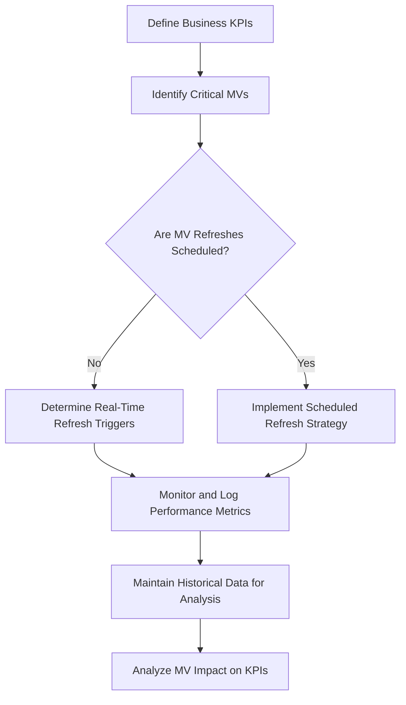

# Explain how you'd design a materialized-view refresh SLA dashboard that ties refresh cost and freshness directly to business KPIs so leadership can prioritize.

**Difficulty:** Deep · **Levels:** Architect/Principal, SDE-2/3 · [↑ Materialized View Refresh and Maintenance](<../../../../01_Databases_and_SQL/Database_Objects/Materialized_Views/Materialized_View_Refresh_and_Maintenance.md>)

> ⚠️ Practice answer, not verified. Some answers contain mistakes; when in doubt, follow the lesson.

## Answer

To design an effective materialized view (MV) refresh SLA dashboard, we need to integrate several key concepts: understanding the business KPIs, defining the MV refresh strategy, and establishing a cost-freshness relationship that aligns with those KPIs. This involves creating a dynamic, real-time dashboard that provides insights into the performance of MVs, enabling leadership to make informed decisions about resource allocation.

The dashboard will leverage advanced metrics such as latency, cost, and impact on query performance. We'll also consider factors like data skewness and update frequency when designing refresh strategies. By tying these metrics directly to business KPIs, we ensure that the dashboard is not just a technical tool but a strategic asset for leadership.

**Code:**

```

graph TD; A[Define Business KPIs] --> B(Identify Critical MVs); B --> C{Are MV Refreshes Scheduled?}; C -->|Yes| D[Implement Scheduled Refresh Strategy]; C -->|No| E[Determine Real-Time Refresh Triggers]; D --> F[Monitor and Log Performance Metrics]; E --> G[Maintain Historical Data for Analysis]; H[Analyze MV Impact on KPIs] --> A;

CODE
Copy

(ASCII diagram)


**Example input / output:**

| KPI | Target Value | Current Value |
|-----|--------------|---------------|
| Revenue | $500,000 | $480,000 |
| Customer Retention | 90% | 87% |
| MV Stat | Value |
|---------|-------|
| Refresh Time | 1 hour |
| Total Cost | $20 |
| Query Impact Reduction | 30% |

**Data:**

```json
{
  "KPIs": {
    "Revenue": { "target": 500000, "current": 480000 },
    "Customer Retention": { "target": 90, "current": 87 }
  },
  "MVStats": {
    "refreshTime": "1 hour",
    "totalCost": "$20",
    "queryImpactReduction": "30%"
  }
}
```

**Flow:**

1. (ASCII diagram)
2. Yes
3. No
4. Define Business KPIs
5. Identify Critical MVs
6. Are MV Refreshes Scheduled?
7. Implement Scheduled RefreshStrategy
8. Determine Real-Time RefreshTriggers
9. Monitor and Log PerformanceMetrics
10. Maintain Historical Data forAnalysis
11. Analyze MV Impact on KPIs
12. {
13. "KPIs": {
14. "Revenue": { "target": 500000, "current": 480000 },
15. "Customer Retention": { "target": 90, "current": 87 }
16. },
17. "MVStats": {
18. "refreshTime": "1 hour",
19. "totalCost": "$20",
20. "queryImpactReduction": "30%"
21. }
22. }
23. | KPI | Target Value | Current Value |
24. |-----|--------------|---------------|
25. | Revenue | $500,000 | $480,000 |
26. | Customer Retention | 90% | 87% |
27. | MV Stat | Value |
28. |---------|-------|
29. | Refresh Time | 1 hour |
30. | Total Cost | $20 |
31. | Query Impact Reduction | 30% |
32. | KPIs | Description |
33. |------|-------------|
34. | Revenue | Targeted monthly revenue amount. |
35. | Customer Retention | Percentage of customers retained over a given period. |
36. | MV Stats | Description |
37. |----------|-------------|
38. | Refresh Time | Frequency at which the materialized view is updated. |
39. | Total Cost | Financial cost associated with refreshing the materialized view. |
40. | Query Impact Reduction | Percentage improvement in query performance due to using the materialized view. |

