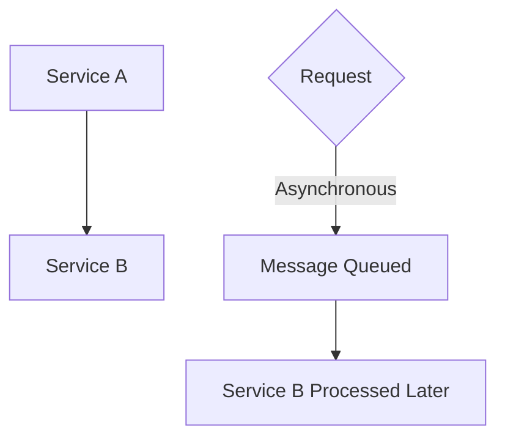

# What is the difference between synchronous and asynchronous communication between services?

**Difficulty:** Basic · **Levels:** Architect/Principal, Fresher, SDE-1, SDE-1/2, SDE-2/3 · [↑ Offset Commit Modes](<../../../../03_Big_Data_and_Streaming/Streaming_and_Messaging/Event_Driven_Architecture/Offset_Commit_Modes.md>)

> ⚠️ Practice answer, not verified. Some answers contain mistakes; when in doubt, follow the lesson.

## Answer

In a microservices architecture, services communicate in two primary ways: synchronously (blocking) and asynchronously (non-blocking). Synchronous communication involves one service making a request to another and waiting for an immediate response before proceeding. Asynchronous communication allows services to send messages without waiting for a reply, enabling them to operate independently and in parallel.

To understand the differences and implications of each approach, let's start from first principles.

**Code:**

```

graph TD; A[Service A] --> B[Service B]; C{Request} -- Synchronous --> D[Wait for Response] --> E[Response Received] F[Message Queue] --> G[Service B] --> H[Process Message] --> I[Send Response]

CODE
Copy


**Flow:**

1. Synchronous
2. Asynchronous
3. Service A
4. Send Request to Service B
5. Synchronous vs Asynchronous
6. Wait for Response
7. Receive Response
8. Synchronous vs Asynchronous
9. Message Queued
10. Process Message Later

