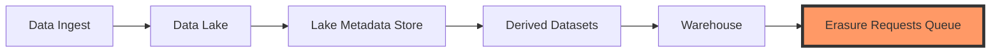

# How do you architect PII handling across a lake and warehouse so that right-to-erasure (GDPR/DPDP) is actually achievable when data has been copied into hundreds of derived datasets?

**Difficulty:** Expert · **Levels:** Architect/Principal, SDE-2/3 · [↑ GDPR Deletion in Immutable Lakes](<../../../../04_Data_Architecture_and_Strategy/Architecture_Patterns/Data_Architecture/Layered_Pipelines_Bronze_Silver_Gold/GDPR_Deletion_in_Immutable_Lakes.md>)

> ⚠️ Practice answer, not verified. Some answers contain mistakes; when in doubt, follow the lesson.

## Answer

To ensure GDPR-compliant right-to-erasure (RTRE) across a data lake and warehouse architecture, we need to design a system that allows us to track, trace, and delete PII from multiple derived datasets efficiently. The core challenge here is maintaining the integrity of the data lineage while ensuring that deletions can be cascaded down through various layers.

The question essentially asks how to manage PII in such a way that when a user requests their data to be erased, we can do so without violating other access controls or compromising the availability and consistency of our data. The key idea is to leverage metadata management and robust data lineage tracking mechanisms.

**Code:**

```
Example of using a simple Python dictionary to track PII in derived datasets

derived_datasets = { 'ds1': {'pii_fields': ['email', 'phone_number'], 'owner': 'data_science'}, 'ds2': {'pii_fields': ['credit_card'], 'owner': 'finance'} }

CODE
Copy



**Data:**

```yaml
# Sample metadata schema for PII tracking in the lake and warehouse architecture
metadata_schema:
  pii_fields: [email, phone_number, credit_card]
  erasure_requests_queue: [
    {user_id: '12345', fields_to_erase: ['phone_number'], dataset_ids: ['ds1']}
  ]
```

**Flow:**

1. Data Ingest
2. Data Lake
3. Lake Metadata Store
4. Derived Datasets
5. Warehouse
6. Erasure Requests Queue
7. # Sample metadata schema for PII tracking in the lake and warehouse architecture
8. metadata_schema:
9. pii_fields: [email, phone_number, credit_card]
10. erasure_requests_queue: [
11. {user_id: '12345', fields_to_erase: ['phone_number'], dataset_ids: ['ds1']}
12. ]
13. Input:
14. - User ID: 12345
15. - Fields to Erase: phone_number
16. - Dataset IDs: ds1
17. Output:
18. - Metadata updated in the lake and warehouse architecture to mark 'phone_number' for erasure.
19. - Queue item added to the 'Erasure Requests Queue': {user_id: '12345', fields_to_erase: ['phone_number'], dataset_ids: ['ds1']}

