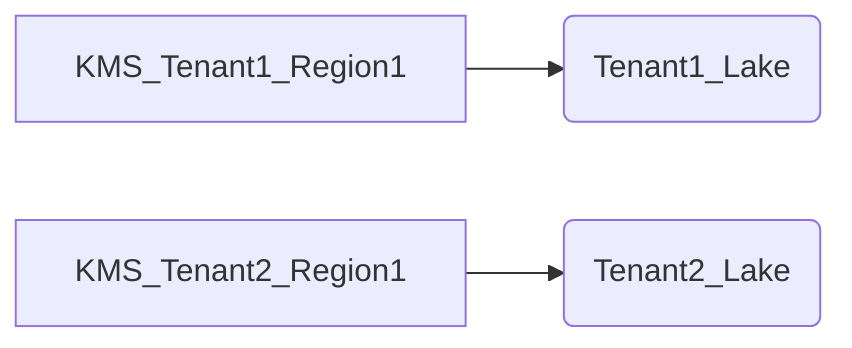

# How do you architect encryption and key management across a telemetry lake so per-tenant/per-region key isolation and crypto-shredding of leaked-PII logs are possible without wrecking the columnar scan performance your AIOps queries depend on?

**Difficulty:** Expert · **Levels:** Architect/Principal, SDE-2/3 · [↑ Multi-tenant Data Platform Isolation](<../../../../04_Data_Architecture_and_Strategy/Architecture_Patterns/Data_Architecture/Layered_Pipelines_Bronze_Silver_Gold/Multi-tenant_Data_Platform_Isolation.md>)

> ⚠️ Practice answer, not verified. Some answers contain mistakes; when in doubt, follow the lesson.

## Answer

TL;DR

To architect encryption and key management in a telemetry lake, we need to ensure per-tenant/per-region key isolation while supporting efficient columnar scans required by AIOps queries. This involves using a combination of data mesh architecture principles, robust key management systems (KMS), and careful design of our data schema.

#### Triaging the Question

The question is asking about how to implement encryption and key management in a telemetry lake such that:

Per-tenant/per-region key isolation can be achieved.
Crypto-shredding of leaked PII logs is possible without affecting performance, particularly columnar scan operations.

#### Assumptions
We are dealing with a large-scale system where multiple tenants and regions exist.
AIOps queries depend on efficient columnar scans for real-time analysis.
There is potential risk of data breaches or leaks (PII).

#### First Principles Solution

Data Mesh Architecture:

Organize the telemetry lake into logical buckets per tenant and region.
Each bucket should have its own encryption keys, ensuring isolation.

Key Management System (KMS):

Use a KMS to manage different types of keys for each tenant/region.
Employ hardware security modules (HSMs) or cloud-based KMS services like AWS KMS or Azure Key Vault.

Encryption Strategy:

Implement column-level encryption using transparent data encryption (TDE).
Use data at rest and in transit encryption to ensure all communications are secure.

Columnar Scan Performance:

Design the schema such that encrypted columns do not impede scan performance.

#### Cons
ider using homomorphic encryption or other advanced techniques for complex queries.

Crypto-Shredding:

Implement policies within KMS to automatically delete keys and encrypted data after a set period if no access is detected.
Use watermarking techniques to ensure that even if data leaks, it can be easily identified as tampered.
Step-by-Step Solution

Define Tenants and Regions:

Tenant 1
Tenant1_Lake
Region 1
Tenant 2
Tenant2_Lake
Region 2

Key Management:

Use a KMS for each tenant and region.
KMS_Tenant1_Region1
Tenant1_Lake
KMS_Tenant2_Region1
Tenant2_Lake

Data Schema Design:

Encrypt columns with sensitive data.
SQL
CREATE TABLE TelemetryLogs (
    id INT,
    tenant_id VARCHAR(50),
    region_id VARCHAR(50),
    log_time TIMESTAMP,
    pii_data ENCRYPTED BY 'KMS_Tenant1_Region1',
    metadata TEXT
);

Columnar Scan Optimization:

Use materialized views or pre-aggregated tables for common queries.
SQL
CREATE MATERIALIZED VIEW AggregatedLogs AS SELECT tenant_id, region_id, COUNT(*) FROM TelemetryLogs GROUP BY tenant_id, region_id;

Crypto-Shredding Implementation:

Set up lifecycle policies in KMS to automatically delete keys and data after 90 days of non-access.
JSON
{
  "Rules": [
    {
      "Status": "Enabled",
      "Description": "Delete old logs and keys",
      "All": {},
      "Exception": {},
      "KeyManagementPolicy": "default"
    }
  ]
}

#### Closing Summary
+ Common Mistakes/Follow-Ups

#### Closing Summary
By leveraging a data mesh architecture, robust KMS, and strategic encryption, we can achieve per-tenant/per-region key isolation while maintaining the necessary performance for AIOps queries. Crypto-shredding ensures that sensitive data is securely deleted over time.

#### Common Mistakes

Overcomplicating Key Management: Over-engineering the key management system can lead to unnecessary complexity and operational overhead.
Neglecting Performance Considerations: Not optimizing columnar scans can result in suboptimal performance for critical queries.
Failing to Implement Crypto-Shredding: Without proper data lifecycle policies, sensitive data may remain exposed longer than necessary.

#### Follow-Ups
Discuss specific tools and technologies used, integration with existing systems, and potential trade-offs between security and performance.

**Code:**

```

CREATE TABLE TelemetryLogs ( id INT, tenant_id VARCHAR(50), region_id VARCHAR(50), log_time TIMESTAMP, pii_data ENCRYPTED BY 'KMS_Tenant1_Region1', metadata TEXT );

CODE
Copy



**Data:**

```json
{
  "Rules": [
    {
      "Status": "Enabled",
      "Description": "Delete old logs and keys",
      "All": {},
      "Exception": {},
      "KeyManagementPolicy": "default"
    }
  ]
}
```

**Flow:**

1. Tenant 1
2. Tenant1_Lake
3. Region 1
4. Tenant 2
5. Tenant2_Lake
6. Region 2

