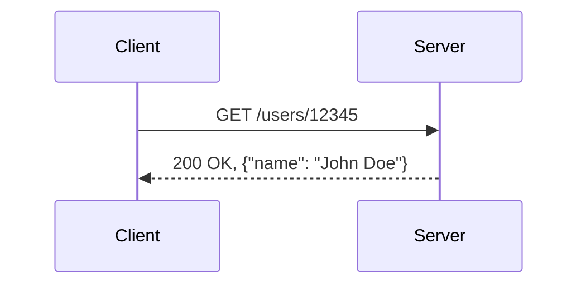

# How would you review a proposed REST API design doc that models everything as POST /rpc with an action field? What specific losses (caching, idempotency, tooling, observability) would you raise and what would you counter-propose?

**Difficulty:** Deep · **Levels:** SDE-1/2, SDE-2/3 · [↑ Distributed Operations Behind an Endpoint](<../../../../07_Distributed_Systems_and_Design/APIs/REST_APIs/Distributed_Operations_Behind_an_Endpoint.md>)

> ⚠️ Practice answer, not verified. Some answers contain mistakes; when in doubt, follow the lesson.

## Answer

To review a proposed REST API design that models everything as POST /rpc with an action field, we need to evaluate several aspects from first principles, including caching, idempotency, tooling support, and observability. The core issue here is the loss of clear HTTP semantics that would otherwise guide proper implementation.

#### Triage

The question is probing for a thorough understanding of REST best practices and the nuances between RPC (Remote Procedure Call) and RESTful APIs. You are expected to identify the potential pitfalls of an overly generalized approach, such as using POST /rpc without distinguishing different actions. This could lead to issues like lack of caching support, potential loss of idempotency, reduced tooling support, and diminished observability.

#### Assumptions
The API is designed to handle various operations via a single endpoint with an action field.
We are reviewing the design from a backend SDE perspective.
Step-by-Step Solution
1. Caching Loss

REST APIs often rely on caching mechanisms like HTTP's GET method for retrieving resources, which can significantly improve performance by reducing the load on servers and network latency. Using a generic POST /rpc endpoint means that caching cannot be applied as efficiently or at all, leading to increased server load and slower response times.

2. Idempotency Loss

Idempotent methods in REST ensure that a client can safely send a request multiple times without changing the outcome beyond the first execution. For example, GET is idempotent because it does not alter any state on the server. Using a generic POST /rpc endpoint means developers must ensure every call is idempotent within their action field logic, which increases complexity and potential for errors.

3. Tooling Support

REST tools like Postman, Swagger, or API documentation generators are designed to work well with explicit HTTP methods (e.g., GET, POST, PUT). Using a generic POST /rpc endpoint reduces the utility of these tools as they cannot provide context about the operation being performed just by looking at the request method. This makes debugging and testing more challenging.

4. Observability

REST APIs benefit from clear logging and monitoring practices that can be applied to specific methods (e.g., GET /users vs. POST /users). A generic POST /rpc endpoint complicates these practices, making it harder to understand what actions are being performed, which operations have been successful or failed, and where bottlenecks might occur.

5. Counter-Proposed Solution

Instead of using a generic POST /rpc, I would propose breaking down the API into more specific HTTP methods with meaningful paths and query parameters:

HTTP
# Example actions:
GET /users                  -> Retrieve all users
GET /users/{userId}         -> Retrieve user by ID
POST /users                 -> Create a new user
PUT /users/{userId}         -> Update user information
DELETE /users/{userId}      -> Delete a user

# For more complex operations, consider:
POST /transactions          -> Perform a financial transaction (e.g., transfer funds)
GET /search/users?q=query  -> Search for users with a query string

This approach leverages the strengths of REST by using appropriate HTTP methods and paths to ensure better caching, idempotency, tooling support, and observability.

#### Closing Summary
+ Common Mistakes/Follow-Ups

Using POST /rpc without clear delineation can lead to significant maintenance issues. It is essential to design APIs that adhere to well-established conventions where possible, as this improves the overall robustness and maintainability of your system. In follow-ups, you might be asked about specific cases where a generic approach could be beneficial; for instance, in microservices architectures with complex state transitions, a single POST /rpc might be necessary to encapsulate all operations.

Self-Check

Correctness + completeness confirmed.

**Comparison:**

```
HTTP Method	Description	Example
GET	Retrieve a resource	GET /users/12345
POST	Create or update	POST /users
PUT	Update existing	PUT /users/12345
DELETE	Delete a resource	DELETE /users/12345
```

**Code:**

```

sequenceDiagram participant Client participant Server

CODE
Copy
Client->>Server: POST /users
Server-->>Client: 201 Created, Location: /users/12345
CODE
Copy



**Example input / output:**

```text
- **Input:** `POST /users` with JSON payload `{ "name": "John Doe" }`
- **Output:** `201 Created`, Location: `/users/12345`

- **Input:** `GET /users/12345`
- **Output:** `200 OK`, `{ "userId": "12345", "name": "John Doe" }`
```

**Data:**

```json
{
  "userId": "12345",
  "name": "John Doe"
}
```

**Flow:**

1. Yes
2. No
3. Client
4. Is Action Known?
5. Send Request with CorrectMethod
6. Use POST /rpc with ActionField
7. API Call Successful
8. Handle Generic Call Logic
9. Generate AppropriateResponse

