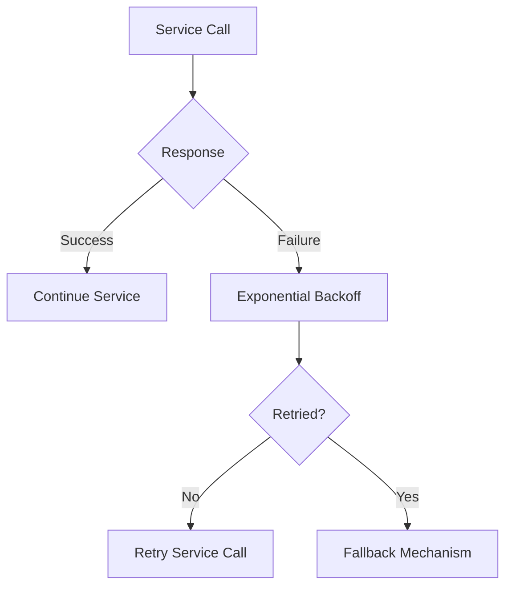

# You must design for graceful degradation as a first-class property, not an afterthought — describe how you'd classify every dependency by criticality and encode the fallback behavior so degradation is tested, not hoped-for.

**Difficulty:** Expert · **Levels:** Architect/Principal, SDE-2/3 · [↑ Backpressure and Load Shedding](<../../../../07_Distributed_Systems_and_Design/System_Design/High_Level_Design/Backpressure_and_Load_Shedding.md>)

> ⚠️ Practice answer, not verified. Some answers contain mistakes; when in doubt, follow the lesson.

## Answer

#### Overview

When designing systems, especially complex backend architectures, it's crucial to ensure that graceful degradation is a first-class property rather than an afterthought. This means classifying every dependency by its criticality and encoding fallback behaviors explicitly. In this solution, we'll classify dependencies based on their importance, define fallback strategies, and ensure these strategies are rigorously tested.

#### Triage

The question asks us to design for graceful degradation as a core property of the system. The key aspects include:

Classifying Dependencies: Categorizing each dependency (e.g., databases, external APIs) by its criticality.
Encoding Fallbacks: Defining and implementing fallback behaviors for less-critical dependencies.
Testing Degradation: Ensuring that the fallback mechanisms are thoroughly tested to validate their effectiveness.

#### First-Principles Solution

Dependency Classification:

Critical Dependencies: These include essential services such as database connections, authentication providers, or core business logic components.
Non-Critical Dependencies: These could be external APIs like third-party payment gateways or weather services that do not impact the core functionality if unavailable.

Fallback Strategies:

For critical dependencies, we might implement retry mechanisms with exponential backoff and circuit breakers to prevent cascading failures.
For non-critical dependencies, simpler fallbacks such as caching locally used data, using mock services during outages, or gracefully failing without impacting the primary business logic.

Testing Degradation:

Use load testing tools (like JMeter) and simulate dependency failures to verify that the fallback mechanisms work as intended.
Implement continuous integration pipelines that include tests for degradation scenarios.
Step-by-Step Solution

Dependency Identification: Identify all dependencies in the system using a tool like Spring Cloud or service mesh solutions like Istio, which can help map out inter-service calls and external API integrations.

Criticality Assessment: Use a scoring mechanism to assess each dependency's criticality based on its impact on core business functionality. For example, a score of 1-5 could be used where 1 is non-critical and 5 is highly critical.

Fallback Mechanisms:

Circuit Breaker: Implement circuit breakers for critical services to prevent failure propagation.
Success
Failure
Service Call
Circuit Breaker
Response
Continue Service
Fallback Mechanism
Retry Logic: For non-critical services, implement retry logic with exponential backoff.
Success
Failure
No
Yes
Service Call
Response
Continue Service
Exponential Backoff
Retried?
Retry Service Call
Fallback Mechanism

Testing Degradation:

Use a combination of manual and automated testing to ensure fallback mechanisms work.
Set up CI/CD pipelines that include tests for degradation scenarios.

#### Closing Summary

Graceful degradation is crucial for building robust, reliable systems. By classifying dependencies by criticality, encoding explicit fallback behaviors, and rigorously testing these strategies, we can ensure that our system remains functional even when facing unexpected failures or outages.

#### Common Mistakes/Follow-Ups
Mistake: Treating graceful degradation as an afterthought rather than a core design principle.

#### Follow-Up
Discuss the importance of including degradation tests in CI/CD pipelines and the impact of not doing so on system reliability.

**Comparison:**

```
Dependency Name	Criticality Score
Database	5
Payment Gateway	2
Weather Service	1
```

**Code:**

```

graph TD; A[Service Call] --> B[Circuit Breaker]; B --> C{Response}; C -->|Success| D[Continue Service]; C -->|Failure| E[Fallback Mechanism];

CODE
Copy



**Example input / output:**

```
Input: Simulating a failure in the paymentGateway service.
Output: Fallback logic kicks in, and the system continues to function without payment processing.
MARKDOWN
Copy
| Input                         | Output                                                      |
|-------------------------------|-------------------------------------------------------------|
| Failure in paymentGateway      | System continues operation using cached or fallback payments |
```

**Data:**

```yaml
# Example Dependency Criticality Scoring
dependencies:
  - name: database
    criticality: 5
  - name: paymentGateway
    criticality: 2
  - name: weatherService
    criticality: 1
```

**Flow:**

1. Success
2. Failure
3. Service Call
4. Circuit Breaker
5. Response
6. Continue Service
7. Fallback Mechanism
8. Success
9. Failure
10. No
11. Yes
12. Service Call
13. Response
14. Continue Service
15. Exponential Backoff
16. Retried?
17. Retry Service Call
18. Fallback Mechanism

