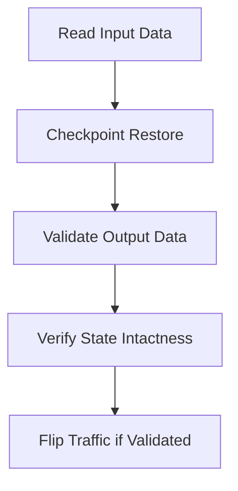

# How do you validate that a savepoint restored correctly and the anomaly state is intact before flipping traffic to the new job?

**Difficulty:** Deep · **Levels:** SDE-1/2, SDE-2/3 · [↑ Checkpointing and Recovery](<../../../../TOOLS/Apache_Flink/Flink_Core/Checkpointing_and_Recovery.md>)

> ⚠️ Practice answer, not verified. Some answers contain mistakes; when in doubt, follow the lesson.

## Answer

To ensure that a saved checkpoint restored correctly in Apache Flink and that any anomaly states are intact, we need to validate both the consistency of the data processed after restoration and the integrity of the state transitions. This involves several steps, including checking the output data for correctness, verifying the state snapshot, and ensuring the job's internal state aligns with expected values.

**Comparison:**

| ID | Value |
|----|-------|
| 1  | 2.0   |
| 2  | 3.0   |
| ID | Processed Value |
|----|----------------|
| 1  | 4.0            |
| 2  | 6.0            |

**Code:**

```
Example Python code snippet to validate a Flink checkpoint

from pyflink.dataset import ExecutionEnvironment from pyflink.table import BatchTableEnvironment, TableConfig, DataTypes from pyflink.table.descriptors import Schema, OldCsv, FileSystem

env = ExecutionEnvironment.get_execution_environment() t_config = TableConfig() t_env = BatchTableEnvironment.create(env, t_config)

Define the schema for input and output data

input_schema = Schema().field("id", DataTypes.INT()).field("value", DataTypes.DOUBLE()) output_schema = Schema().field("id", DataTypes.INT()).field("processed_value", DataTypes.DOUBLE())

Set up the source and sink paths

source_path = 'file:///path/to/input' sink_path = 'file:///path/to/output'

Read input data from a file (replace with your actual path)

t_env.connect(FileSystem().path(source_path))
.with_format(OldCsv() .field('id', DataTypes.INT()) .field('value', DataTypes.DOUBLE()))
.with_schema(input_schema)
.register_table_source("InputTable")

Define the Flink job logic (simplified)

t_env.scan("InputTable")
.select("id, value * 2 as processed_value")
.insert_into(FileSystem().path(sink_path))

Execute and write to disk

t_env.execute("Checkpoint Validation")

CODE
Copy



**Example input / output:**

```text
Given input data:
[{"id": 1, "value": 2.0}, {"id": 2, "value": 3.0}]

Expected output after processing (assuming a doubling operation):
[{"id": 1, "processed_value": 4.0}, {"id": 2, "processed_value": 6.0}]
```

**Data:**

```json
{
  "input": [
    {"id": 1, "value": 2.0},
    {"id": 2, "value": 3.0}
  ],
  "expected_output": [
    {"id": 1, "processed_value": 4.0},
    {"id": 2, "processed_value": 6.0}
  ]
}
```

**Flow:**

1. Read Input Data
2. Checkpoint Restore
3. Validate Output Data
4. Verify State Intactness
5. Flip Traffic if Validated

