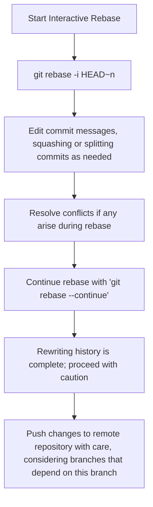

# You need to split a giant already-merged 'add whole pipeline' commit into logically separate commits for a clean future revert story. Walk through interactive rebase 'edit' plus reset, and the exact risks if the commit is already public and branched from.

**Difficulty:** Deep · **Levels:** SDE-1/2, SDE-2/3 · [↑ Interactive Rebase](<../../../../TOOLS/Git_and_GitHub/Git_Core/Interactive_Rebase.md>)

> ⚠️ Practice answer, not verified. Some answers contain mistakes; when in doubt, follow the lesson.

## Answer

When dealing with large, unwieldy Git commits that need to be broken down into smaller, more manageable chunks, especially when those commits have been merged and may affect multiple branches, using interactive rebase is an effective approach. This method allows you to split the commit history in a way that keeps your repository's history clean for future operations like reverting changes.

In this scenario, we're working with a public Git commit on a branched version of the mainline code base. The key risk here involves modifying public commit history, which can lead to complications if other developers have based their work on this branch. Let’s walk through the steps and discuss the potential risks involved.

**Code:**

```
Example repository setup

git clone <repo-url> cd repo-name

CODE
Copy



**Data:**

```json
{
  "commit_message": "Add whole pipeline",
  "branch_name": "feature/pipeline-updates"
}
```

**Flow:**

1. Start Interactive Rebase
2. git rebase -i HEAD~n
3. Edit commit messages,squashing or splitting commitsas needed
4. Resolve conflicts if any ariseduring rebase
5. Continue rebase with 'gitrebase --continue'
6. Rewriting history is complete;proceed with caution
7. Push changes to remoterepository with care,considering branches thatdepend on this branch
8. {
9. "commit_message": "Add whole pipeline",
10. "branch_name": "feature/pipeline-updates"
11. }
12. # Initial commit history (simplified)
13. - Merge commit: Add whole pipeline
14. # After interactive rebase
15. 1. Commit: Update database connection settings
16. 2. Commit: Implement logging for pipeline
17. 3. Commit: Refactor initial setup scripts
18. 4. Commit: Finalize UI integration

